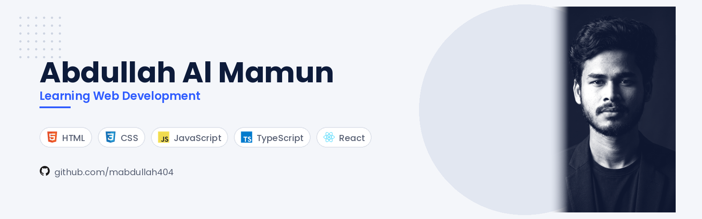

  

<h1 align="center">Hi there, I'm Abdullah Al Mamun 👋</h1>

  

  
  
  
  

---

### 👨‍💻 About Me

I'm an undergraduate **Computer Science & Engineering (CSE)** student at BUBT and a passionate **Full-Stack Web Developer** based in Dhaka, Bangladesh.

I love building performant, accessible, and user-centric web applications. My daily driver stack revolves around **Next.js (App Router), React, Node.js, Express, and MongoDB**, paired with modern utility styling using **Tailwind CSS & shadcn/ui**. I focus on writing clean, modular code and solving real-world problems through robust full-stack architectures.

- 🎓 **Academics:** Pursuing B.Sc. in Computer Science & Engineering at **BUBT**
- 💻 **Core Focus:** Full-Stack Web Development, Modern Frontend Architectures, and RESTful APIs
- 🌱 **Currently Diving Deeper Into:** Next.js Server Components, Authentication Systems (BetterAuth), and Database Optimization
- 📍 **Location:** Dhaka, Bangladesh
- 💬 **Ask me about:** JavaScript, React, Next.js, Tailwind CSS, or full-stack web workflows

---

### 🛠️ Tech Stack & Skills

**Frontend & Styling**

  
  
  
  
  
  
  
  
  

**Backend, Auth & Database**

  
  
  
  
  

**Tools & Workflow**

  
  
  
  
  

---

### 🚀 Production & Featured Projects

<table>
  <!-- Row 1: Football Prediction & CivicPulse -->
  <tr>
    <td width="50%" valign="top">
      <h3>⚽ Football Prediction Platform</h3>
      
An interactive sports platform allowing users to predict football match outcomes, track upcoming fixtures, and review dynamic leaderboards.

      
<b>Tech:</b> JavaScript, React, Tailwind CSS, REST APIs, Vercel

      

        <a href="https://football-prediction-platform-neon.vercel.app" target="_blank"><b>🔗 Live Application</b></a> • 
        <a href="https://github.com/mabdullah404/football_prediction-platform" target="_blank"><b>💻 GitHub Repo</b></a>
      

    </td>
    <td width="50%" valign="top">
      <h3>🤝 CivicPulse — Volunteer Action Network</h3>
      
A full-stack community development hub enabling conscious citizens to publish, join, and coordinate local social impact drives.

      
<b>Tech:</b> Next.js 16, React 19, Express, MongoDB, Better Auth, Tailwind CSS

      

        <a href="https://social-development-platform.vercel.app" target="_blank"><b>🔗 Live Application</b></a> • 
        <a href="https://github.com/mabdullah404/social_devlopment_platform" target="_blank"><b>💻 Client</b></a> • 
        <a href="https://github.com/mabdullah404/server_social_development" target="_blank"><b>⚙️ Server</b></a>
      

    </td>
  </tr>

  <!-- Row 2: PizzaHub & Frameora -->
  <tr>
    <td width="50%" valign="top">
      <h3>🍕 PizzaHub — Food Ordering Platform</h3>
      
A full-stack culinary storefront with instant cart calculation, menu filtering, and custom order state management.

      
<b>Tech:</b> React, Node.js, Express.js, MongoDB, Tailwind CSS

      

        <a href="https://pizzahub-client-tan.vercel.app" target="_blank"><b>🔗 Live Application</b></a> • 
        <a href="https://github.com/mabdullah404/pizzahub-client" target="_blank"><b>💻 Client</b></a> • 
        <a href="https://github.com/mabdullah404/pizzahub-server" target="_blank"><b>⚙️ Server</b></a>
      

    </td>
    <td width="50%" valign="top">
      <h3>🖼️ Frameora — Visual Showcase Gallery</h3>
      
A high-performance interactive gallery featuring masonry media grids, category filtering, and modal viewer previews.

      
<b>Tech:</b> React, JavaScript, Tailwind CSS, Vercel

      

        <a href="https://frameora-delta.vercel.app" target="_blank"><b>🔗 Live Application</b></a> • 
        <a href="https://github.com/mabdullah404/Frameora" target="_blank"><b>💻 GitHub Repo</b></a>
      

    </td>
  </tr>

  <!-- Row 3: Personal Portfolio & Bazar Dor -->
  <tr>
    <td width="50%" valign="top">
      <h3>⚡ Personal Developer Portfolio</h3>
      
An obsidian & white themed personal engineering website featuring interactive cards, light/dark mode, and project showcases.

      
<b>Tech:</b> Next.js 16, React 19, TypeScript, Tailwind CSS v4

      

        <a href="https://personal-portfolio-green-one-68.vercel.app/" target="_blank"><b>🔗 Live Application</b></a> • 
        <a href="https://github.com/mabdullah404/personal-portfolio" target="_blank"><b>💻 GitHub Repo</b></a>
      

    </td>
    <td width="50%" valign="top">
      <h3>🛒 Bazar Dor — Commodity Price Tracker</h3>
      
A localized essential grocery and market commodity price tracker designed for daily budget monitoring.

      
<b>Tech:</b> React, JavaScript, Tailwind CSS, REST APIs

      

        <a href="https://bazar-dor-project-omega.vercel.app/" target="_blank"><b>🔗 Live Application</b></a> • 
        <a href="https://github.com/mabdullah404/bazar-dor-project" target="_blank"><b>💻 GitHub Repo</b></a>
      

    </td>
  </tr>
</table>

---

### 📊 GitHub Activity & Insights

  
  

  

---

  

  <i>"Writing clean code, learning relentlessly, and building software that creates real impact. 🚀"</i>

