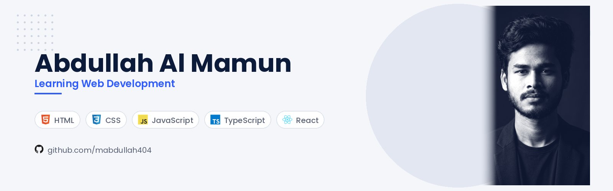

  

<h1 align="center">Hi there, I'm Abdullah Al Mamun 👋</h1>

  

  
  
  
  

---

### 👨‍💻 About Me

I'm an undergraduate **Computer Science & Engineering (CSE)** student at BUBT and a passionate **Full-Stack Web Developer** based in Dhaka, Bangladesh.

I love building performant, accessible, and user-centric web applications. My daily driver stack revolves around **Next.js (App Router), React, Node.js, Express, and MongoDB**, paired with modern utility styling using **Tailwind CSS**. I focus on writing clean, modular code and solving real-world problems through robust full-stack architectures.

- 🎓 **Academics:** Pursuing B.Sc. in Computer Science & Engineering at **BUBT**
- 💻 **Core Focus:** Full-Stack Web Development, Modern Frontend Architectures, and RESTful APIs
- 🌱 **Currently Diving Deeper Into:** Next.js Server Components, Authentication Systems (BetterAuth), and Database Optimization
- 📍 **Location:** Dhaka, Bangladesh
- 💬 **Ask me about:** JavaScript, React, Next.js, Tailwind CSS, or full-stack web workflows

---

### 🛠️ Tech Stack & Skills

**Frontend & Styling**

  
  
  
  
  
  
  
  

**Backend, Auth & Database**

  
  
  
  
  

**Tools & Workflow**

  
  
  
  

---

### 🚀 Featured Projects

#### 1. 🌟 [CivicPulse — Grassroots Action & Volunteer Network](https://github.com/mabdullah404/social_devlopment_platform)
> A full-stack community development and social drive platform where conscious citizens create, discover, and join verified local initiatives (winter relief, blood donation, city cleanup, tree plantation).
- **Tech Stack:** Next.js 16, React 19, Express.js, MongoDB, BetterAuth (Google OAuth + Credentials), Tailwind CSS v4, DaisyUI.
- **Key Highlights:** Strict future-date validation, real-time volunteer enrollment tracking, private organizer dashboard, multi-parameter causes filter, and responsive UI.
- 🔗 **[Live Demo](https://social-development-platform.vercel.app)** • 💻 **[Client Repo](https://github.com/mabdullah404/social_devlopment_platform)** • ⚙️ **[Server Repo](https://github.com/mabdullah404/server_social_development)**

#### 2. ⚡ [Personal Developer Portfolio](https://github.com/mabdullah404/personal-portfolio)
> A modern developer portfolio showcasing software engineering projects, technical skills, and educational background.
- **Tech Stack:** Next.js 16, React 19, TypeScript, Tailwind CSS v4.
- **Key Highlights:** Smooth micro-interactions, responsive obsidian & white card layout, persistent light/dark mode, and dynamic project filtering.
- 🔗 **[Live Demo](https://personal-portfolio-green-one-68.vercel.app/)** • 💻 **[GitHub Repo](https://github.com/mabdullah404/personal-portfolio)**

#### 3. 🛒 [Bazar Dor — Commodity Market Price Tracker](https://github.com/mabdullah404/bazar-dor-project)
> A web application designed to track and display daily essential commodity and grocery market rates across local markets in Bangladesh.
- **Tech Stack:** React, JavaScript, Tailwind CSS, REST API integration.
- 🔗 **[Live Demo](https://bazar-dor-project-omega.vercel.app/)** • 💻 **[GitHub Repo](https://github.com/mabdullah404/bazar-dor-project)**

---

### 📊 GitHub Activity & Insights

  
  

  

---

  

  <i>"Writing clean code, learning relentlessly, and building software that creates real impact. 🚀"</i>

